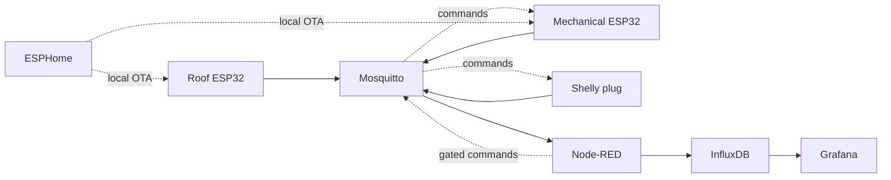

# Architecture and phased implementation

The ESP32 nodes and Shelly communicate on a dedicated, locally routed HVAC
network. Mosquitto distributes observations; Node-RED consumes them and is the
intended home of control and alarm logic. InfluxDB stores time series and
Grafana visualizes them. ESPHome builds and deploys firmware. The HP T720 runs
the services under Podman on openSUSE Tumbleweed.

## Sequence

1. Inventory hardware, record existing wiring, verify safe physical airflow
   paths and instrument in parallel with legacy control.
2. Deploy local services and verify recovery from a backup.
3. Commission sensors one at a time; measure and record ROM addresses and
   calibrated offsets. Protect the irreplaceable core sensor.
4. Verify telemetry and controller state in observation-only mode; review
   historical data for a full heating and cooling cycle.
5. Design and independently test physical interlocks and an emergency stop;
   commission actuator commands with power isolated before enabling automation.
6. Calibrate the digital twin against measured airflow and temperatures.

Time series are observations, not proof of actual damper position: the
spring-return actuators have no position feedback unless separately fitted.
Likewise, a Shelly relay command is not proof of airflow.
